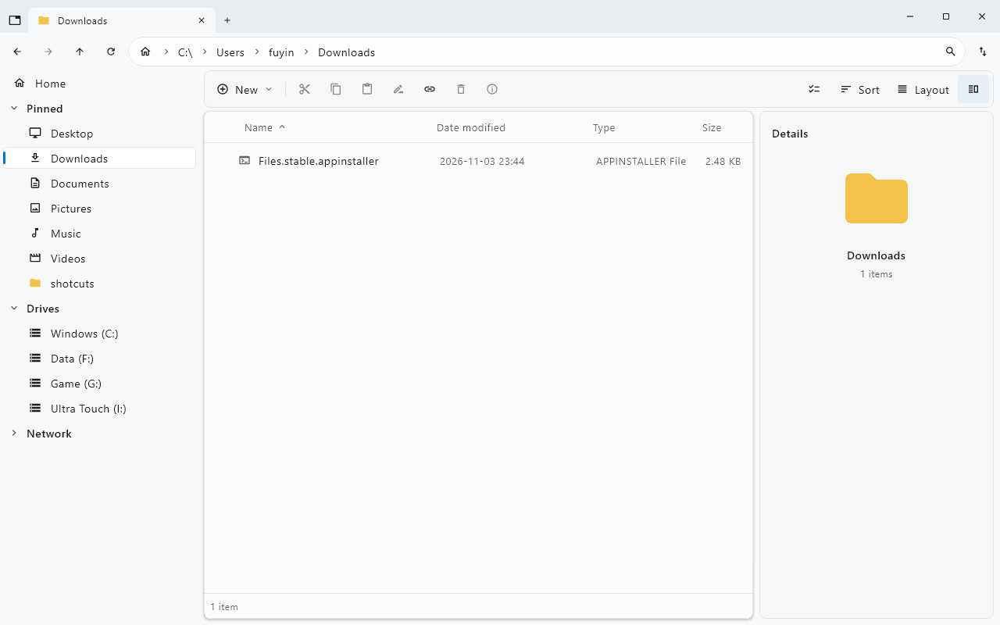

# FilesKmp

[繁體中文](README.md) | English

A Windows desktop file manager built with Kotlin and Compose Multiplatform, with tabs, split panes, search, previews, tags, and customizable shortcut workflows. The current target is Windows only. This project does not implement every feature of the original Files application.



*Existing repository screenshot; appearance can vary by version, language, and settings.*

## Documentation

| Document | 繁體中文 | English |
| --- | --- | --- |
| Project overview | [README](README.md) | This page |
| User manual | [使用者手冊](docs/USER-GUIDE.zh-TW.md) | [User guide](docs/USER-GUIDE.en.md) |
| Change history | [Changelog](CHANGELOG.md) | [Changelog](CHANGELOG.en.md) |

Advanced references: [shortcut format and actions](docs/SHORTCUTS-SPEC.md) and [UI and behavior research notes](MECHANICS.md) (development reference, not a user manual).

## Features

- Tabs and split panes; Details, List, Cards, and Grid layouts.
- Copy, cut, paste, batch rename, ZIP creation/extraction, and Recycle Bin access.
- Name and path search with extension, size, date, wildcard, and regular expression filters.
- Quick Look, thumbnails, metadata editing, tags, and disk usage analysis.
- Customizable toolbar, keyboard bindings, themes, and background pictures.
- Importable and editable shortcut workflows with dry runs, execution logs, and AI-assisted editing.
- Git operations and patch tools (require an available Git environment).

## Install and launch

Choose a published build matching your computer's architecture from [GitHub Releases](https://github.com/creamgod45/FilesKmp/releases). These are packaging naming patterns; consult each release for its actual assets.

| Platform | Installer | Portable |
| --- | --- | --- |
| Windows x64 (Intel / AMD) | `FilesKmp-<version>-windows-x64.msi` | `FilesKmp-<version>-windows-x64-portable.zip` |
| Windows ARM64 | `FilesKmp-<version>-windows-arm64.msi` | `FilesKmp-<version>-windows-arm64-portable.zip` |

Run the MSI and follow the wizard, or extract the entire portable ZIP and launch `FilesKmp/FilesKmp.exe`. Keep the runtime and accompanying files together. Both packages include Java; users do not need to install it separately. The portable build still stores settings in your user profile.

Use PowerShell's `Get-FileHash <downloaded-file> -Algorithm SHA256` to compare a download with the release's SHA256SUMS. The packaging workflow currently does not configure code signing.

## Quick start

1. Choose a folder in the sidebar, or press `Ctrl+L` and enter a path.
2. Press `Ctrl+T` for a new tab or `Ctrl+Shift+S` for side-by-side panes.
3. Select files, then use `Ctrl+C` / `Ctrl+X` and `Ctrl+V` to copy or move them.
4. Press `Ctrl+F` to search, for example `ext:jpg;png`. Press `F1` to view and customize keyboard bindings.
5. Press `Ctrl+,` for Settings. The UI uses Traditional Chinese or English according to the system locale.

See the [user guide](docs/USER-GUIDE.en.md) for instructions and limitations. Features listed here describe the current source; older published builds may provide a subset.

## Build from source

Use Windows and a full JDK. Packaging looks for `jpackage.exe` from JDK 21 or later; CI uses JDK 25. Choose an x64 or ARM64 JDK matching the target architecture. The Gradle Wrapper is included; the first build needs access to dependency downloads. MSI packaging also needs WiX (CI uses 3.14.1).

```powershell
# Run during development
.\gradlew.bat run
# Build the application with its runtime: build/FilesKmp/FilesKmp.exe
.\gradlew.bat windowsApp
# Build an MSI in build/installers/
.\gradlew.bat windowsMsi -PappVersion=1.3.0
# Explicit packaging tool paths (replace with your actual locations)
.\gradlew.bat windowsMsi "-PjdkHome=C:\Java\jdk-25" "-PwixHome=C:\Tools\wix314"
```

`appVersion` in `build.gradle.kts` controls the application version and defaults to `1.3.0`. `package.json` exists for build integration; its version is not the application version source.

## Settings and issue reports

Settings, tags, and session data live in `%APPDATA%\FilesKmp`. Cache lives in `%LOCALAPPDATA%\FilesKmp\Cache`; disk history lives in `%LOCALAPPDATA%\FilesKmp\History`. Close the app before backing up its settings folder.

Report problems through [Issues](https://github.com/creamgod45/FilesKmp/issues), including the application version, Windows version and architecture, reproduction steps, and screenshots or error logs with personal information removed.
