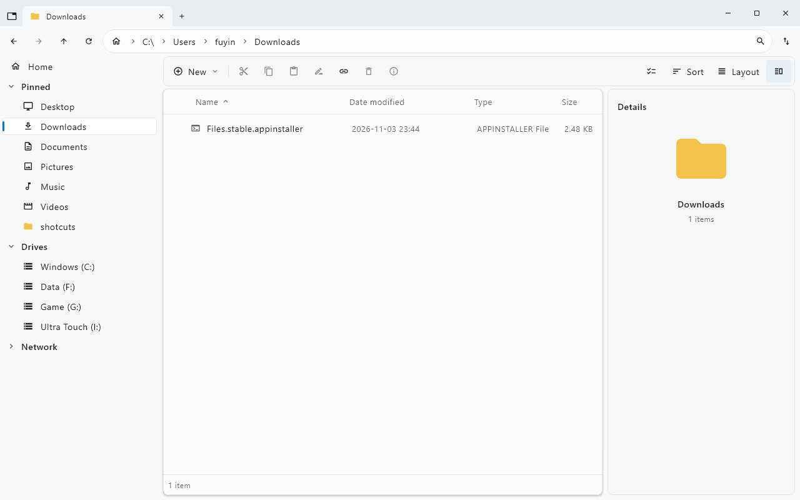

# FilesKmp

繁體中文 | [English](README.en.md)

以 Kotlin 與 Compose Multiplatform 建置的 Windows 桌面檔案管理器，提供分頁、分割畫面、搜尋、預覽、標籤及可自訂捷徑流程。目前僅支援 Windows，並非 Files 原版的完整功能實作。



*儲存庫既有介面截圖；不同版本、語言與設定的畫面可能有所差異。*

## 文件

| 文件 | 繁體中文 | English |
| --- | --- | --- |
| 專案介紹 | 本頁 | [README](README.en.md) |
| 使用者手冊 | [使用者手冊](docs/USER-GUIDE.zh-TW.md) | [User guide](docs/USER-GUIDE.en.md) |
| 更新紀錄 | [Changelog](CHANGELOG.md) | [Changelog](CHANGELOG.en.md) |

進階資料：[捷徑格式與動作參考](docs/SHORTCUTS-SPEC.md)、[介面與行為研究筆記](MECHANICS.md)（開發參考，非使用者手冊）。

## 主要功能

- 分頁與分割畫面；詳細資料、清單、卡片與圖示檢視。
- 複製、剪下、貼上、批次重新命名、ZIP 壓縮與解壓縮、資源回收筒。
- 檔名與路徑搜尋，支援副檔名、大小、日期、萬用字元及正規表示式條件。
- 快速預覽、縮圖、檔案中繼資料編輯、標籤及磁碟空間分析。
- 自訂工具列、鍵盤快速鍵、主題與背景圖片。
- 可匯入與編輯的捷徑流程，含試跑、執行記錄與 AI 輔助編輯。
- Git 操作與修補檔工具（需可用的 Git 環境）。

## 安裝與啟動

從 [GitHub Releases](https://github.com/creamgod45/FilesKmp/releases) 選擇符合電腦架構的已發布版本。下列為封裝命名格式，實際檔案依各 Release 為準。

| 平台 | 安裝版 | 免安裝版 |
| --- | --- | --- |
| Windows x64（Intel / AMD） | `FilesKmp-<版本>-windows-x64.msi` | `FilesKmp-<版本>-windows-x64-portable.zip` |
| Windows ARM64 | `FilesKmp-<版本>-windows-arm64.msi` | `FilesKmp-<版本>-windows-arm64-portable.zip` |

安裝版執行 MSI 後依精靈操作；免安裝版須完整解壓縮，再執行 `FilesKmp/FilesKmp.exe`，並保留同目錄的 runtime 等檔案。兩種封裝均內含 Java runtime，使用者不需另裝 Java。免安裝版仍會將設定寫入使用者資料夾。

可用 PowerShell 的 `Get-FileHash <下載檔案> -Algorithm SHA256` 與該版本的 SHA256SUMS 比對。封裝流程目前未設定程式碼簽章。

## 快速開始

1. 從側邊欄選擇資料夾，或按 `Ctrl+L` 輸入路徑。
2. 按 `Ctrl+T` 開新分頁，或按 `Ctrl+Shift+S` 分割為左右畫面。
3. 選取檔案後以 `Ctrl+C`／`Ctrl+X` 與 `Ctrl+V` 複製或移動。
4. 按 `Ctrl+F` 搜尋，例如 `ext:jpg;png`；按 `F1` 查看與調整快速鍵。
5. 按 `Ctrl+,` 開啟設定。介面會依系統語言環境顯示繁體中文或英文。

完整操作與限制請見[使用者手冊](docs/USER-GUIDE.zh-TW.md)。此處列的是目前原始碼功能；較舊的已發布版本可能尚未包含全部功能。

## 從原始碼建置

在 Windows 使用完整 JDK；封裝程式尋找 JDK 21 以上的 `jpackage.exe`，CI 使用 JDK 25。請使用與目標平台相符的 x64 或 ARM64 JDK。Gradle Wrapper 已包含於專案，首次建置需能下載相依套件。MSI 封裝另需 WiX（CI 使用 3.14.1）。

```powershell
# 開發啟動
.\gradlew.bat run
# 建置含 runtime 的應用程式：build/FilesKmp/FilesKmp.exe
.\gradlew.bat windowsApp
# 建置 MSI：build/installers/
.\gradlew.bat windowsMsi -PappVersion=1.3.0
# 指定封裝工具位置（請換成實際路徑）
.\gradlew.bat windowsMsi "-PjdkHome=C:\Java\jdk-25" "-PwixHome=C:\Tools\wix314"
```

版本以 `build.gradle.kts` 的 `appVersion` 為準，預設 `1.3.0`。`package.json` 僅供建置整合使用，其版本不是應用程式版本來源。

## 設定與回報問題

設定、標籤及工作階段儲存在 `%APPDATA%\FilesKmp`；快取位於 `%LOCALAPPDATA%\FilesKmp\Cache`，磁碟歷史位於 `%LOCALAPPDATA%\FilesKmp\History`。關閉程式後備份設定資料夾，可保留個人設定。

請透過 [Issues](https://github.com/creamgod45/FilesKmp/issues) 附上應用程式版本、Windows 版本與架構、重現步驟及經遮蔽個資的截圖或錯誤記錄。
