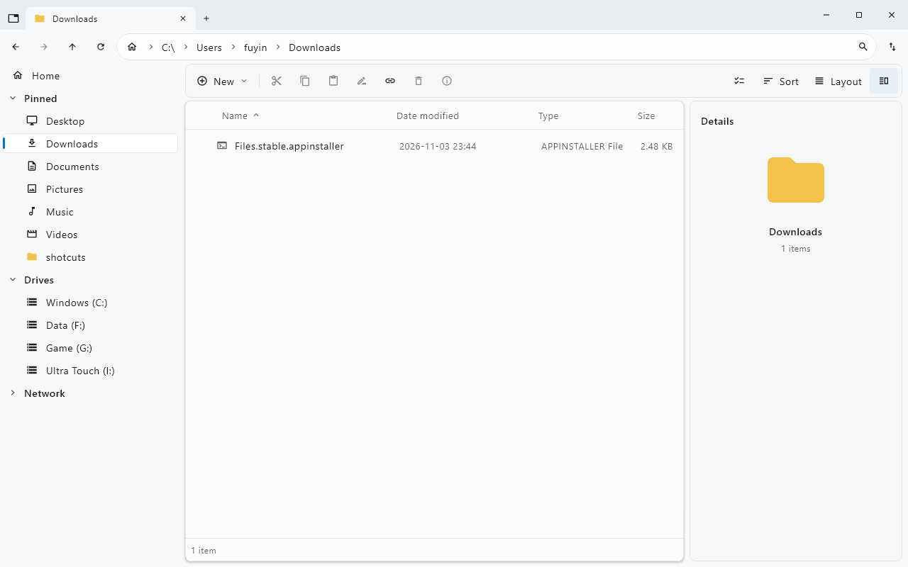
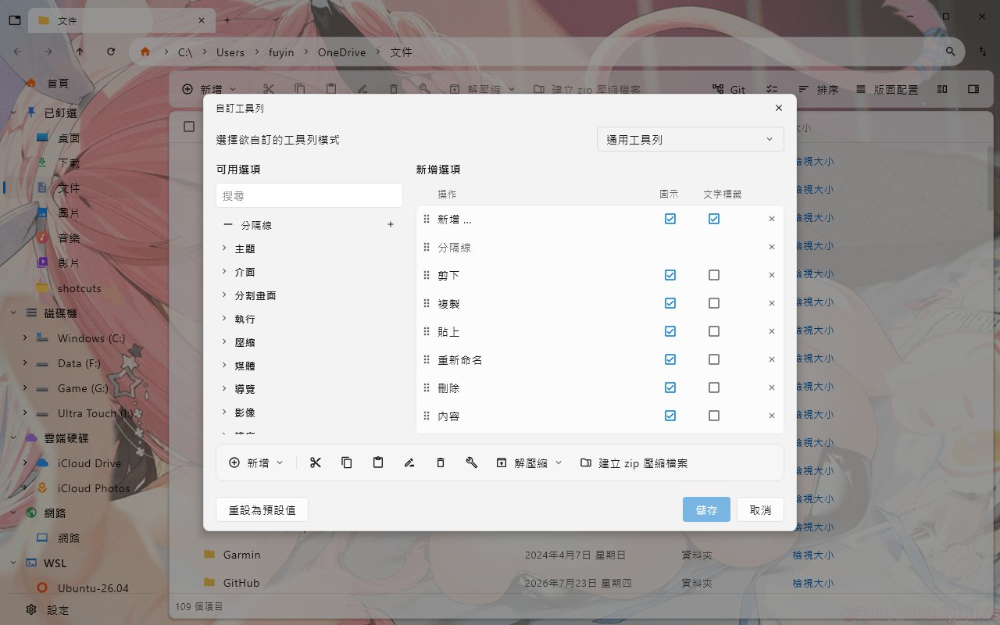

# FilesKmp User Guide

[繁體中文](USER-GUIDE.zh-TW.md) | English · [README](../README.en.md) · [Changelog](../CHANGELOG.en.md)

This guide describes the current source (default build version `1.2.0`). Older published versions may lack some features. Images are existing repository screenshots for identifying controls; appearance varies by version and settings.

## 1. Install and start

1. Choose an x64 or ARM64 package from [Releases](https://github.com/creamgod45/FilesKmp/releases). Check your system type in Windows Settings → System → About.
2. MSI: run the installer, then launch from its shortcut. The default installation folder is `%LOCALAPPDATA%\Programs\FilesKmp`.
3. ZIP: extract the entire archive and run `FilesKmp\FilesKmp.exe`. Keep the EXE together with its runtime and application files.
4. Both packages include Java. The UI uses Traditional Chinese or English according to the system locale. Settings and cache are stored in your user profile.

## 2. Find your way around

*From top to bottom: tabs, address bar, and toolbar. Navigation is on the left, files in the center, and details on the right. This example uses the English UI.*

| Area | Purpose |
| --- | --- |
| Tab strip | Switch folder workspaces; `Ctrl+T` opens a tab, `Ctrl+W` closes it |
| Address bar | Click path segments, or press `Ctrl+L`, enter a folder path, and press Enter |
| Sidebar | Open Home, pinned folders, drives, network locations, and tags |
| Toolbar | Create, copy, paste, sort, and change layouts |
| File area | Select and open items; right-click for applicable commands |
| Details pane | Toggle with `Ctrl+Alt+I` to inspect the selected item |

Home provides widgets such as quick access, drives, and tags. Choose visible widgets in Settings. Network, WSL, and cloud locations depend on what is available or installed on your computer.

## 3. Navigate, use tabs, and split panes

- Open a folder in the file area, or enter its path in the address bar. Press `F5` to refresh.
- Use `Ctrl+Tab` / `Ctrl+Shift+Tab` to cycle tabs; `Ctrl+1` through `Ctrl+9` selects a numbered tab.
- Press `Ctrl+Shift+T` to reopen a closed tab.
- Press `Ctrl+Shift+S` to create side-by-side panes. Click the pane you want to use before navigating, selecting, or pasting. Split-pane toolbar commands let you change the arrangement or close a pane.

## 4. Select, copy, move, and delete

1. Click an item. Hold Ctrl to select multiple items, Shift for a range, or press `Ctrl+A` to select all. Selection checkboxes can be enabled in Settings.
2. Press `Ctrl+C` to copy or `Ctrl+X` to cut, navigate to the destination, and press `Ctrl+V`.
3. Check progress and any options shown for conflicting names. Try a small selection first when planning a large operation.
4. Delete through the toolbar or context menu. Recycling depends on the location and Windows support. `Shift+Delete` permanently deletes items without sending them to the Recycle Bin.
5. Press `Ctrl+Alt+R` to open the Recycle Bin, select items, and use Restore. Within the Recycle Bin, `Ctrl+Z` restores selected items; it is not a general undo for all file operations.

Safe deletion and cleanup tools may permanently remove data. Check the target and on-screen explanation before running them, and keep backups of important files.

## 5. Layouts, sorting, and previews

Use Layout to choose Details, List, Cards, or Grid. Adjust Details columns as needed. Use Sort to change the sort field and direction.

| Default key | Layout |
| --- | --- |
| `Ctrl+Shift+1` | Details |
| `Ctrl+Shift+2` | List |
| `Ctrl+Shift+3` | Cards |
| `Ctrl+Shift+4` | Grid |

Select a file and use the preview command from its menu. Available previews depend on the format and installed Windows preview handlers. Thumbnails can be toggled in Settings. Press `Ctrl+Shift+M` for metadata editing; writable fields depend on the file type.

## 6. Search

Press `Ctrl+F` to focus search, enter a query, and choose the search location using the scope controls. Results may take time while an index is built or updated. If an item is missing, check the scope, case sensitivity, and regular expression switches.

| Example | Meaning |
| --- | --- |
| `report` | Name contains report |
| `ext:jpg;png` | JPG or PNG images |
| `file: size:>10mb` | Files larger than 10 MB |
| `dm:today` | Modified today |
| `dm:>7d` | Modified in the last seven days |
| `folder: backup` | Folders whose names contain backup |
| `path:\Photos\` | Full path contains this fragment |
| `*.pdf` | Wildcard match for PDF names |
| `regex:^IMG_\d+` | Regular expression matching file names |

Spaces combine conditions; `|` means OR and `!` excludes a condition. Quote text containing spaces, such as `"annual report"`. Search matches names, paths, and attributes rather than full file contents.

## 7. Batch rename, archives, and tags

**Batch rename:** select files, press `Ctrl+Shift+F2`, configure the naming rules, inspect the preview, and apply. Use `F2` for a single rename.

**ZIP:** select items and create a ZIP from the toolbar or context menu. To extract, select an archive and choose the destination. Format support depends on the format and system tools.

**Tags:** right-click and choose Edit tags, then select or create tags. Click a sidebar tag to browse tagged items. Tag settings let you rename tags and change colors. Tags are stored by path; renames and moves within FilesKmp update them. Path changes made by other applications may require tagging again.

## 8. Shortcut workflows and AI assistance

Keyboard shortcuts bind keys to commands. Shortcut workflows automate a sequence of actions.

1. Press `Ctrl+Alt+S` to open Manage shortcuts. Create a workflow or import a `.fkflow.json` file.
2. Add inputs and actions in the step editor, or switch to JSON. Each step can pass its output to the next step.
3. Example: get selected files → filter `ext:jpg;png` → copy to a chosen folder.
4. Use Dry run to inspect logs and data flow, then check the source, destination, and parameters before running normally. Dry runs skip file/system-changing actions but can still perform reads and HTTP GET requests; they are not fully offline simulations.
5. Save the workflow for reuse and run it through a key binding or the toolbar. See the [shortcut reference](SHORTCUTS-SPEC.md) for the format and actions.

AI assistance is optional. In the workflow AI settings, choose a provider, model, endpoint, and credentials, then review tool permissions. Conversation and tool-provided content may be sent to the configured service. Before applying generated steps, inspect deletion, overwrite, scripting, network, and messaging actions. AI setup is not needed for ordinary file browsing.

## 9. Customize appearance, toolbar, and keys

*Existing Traditional Chinese screenshot: choose commands on the left, arrange them and toggle icons/text on the right, then inspect the preview below. The background picture is an example of a user's setting.*

- Press `Ctrl+,` for Settings to adjust themes, backgrounds, thumbnails, hidden files, extensions, deletion confirmation, sessions, and Home widgets.
- In Customize toolbar, add or remove commands, drag to reorder them, inspect the preview, and save.
- Press `F1` or `Ctrl+/` for Keyboard shortcuts. Find a command, assign keys, clear bindings, or reset them. Inspect shared bindings when a conflict is shown.
- Keys listed in this guide are defaults. The keyboard editor shows your effective bindings after customization or updates.

## 10. Git, disk analysis, and update information

Use the Git menu inside a repository folder for applicable operations, including creating and applying patches. Ensure Git is available in the environment and inspect the working tree before changing files.

Disk analysis shows space usage. Disk history is saved only when usage recording is enabled. Large folders and network locations can take longer to scan.

The update information page explains changes to your settings and keyboard bindings. The app backs up settings before migration. This page is a local migration report; see the [changelog](../CHANGELOG.en.md) for published feature history.

## 11. Data locations, backup, and troubleshooting

| Location | Contents |
| --- | --- |
| `%APPDATA%\FilesKmp` | Settings, tags, toolbar, key bindings, sessions, update reports, and related data |
| `%LOCALAPPDATA%\FilesKmp\Cache` | Rebuildable thumbnails, native libraries, and other cache |
| `%LOCALAPPDATA%\FilesKmp\History` | Disk usage history when recording is enabled |
| `%LOCALAPPDATA%\Programs\FilesKmp` | Default MSI installation folder |

Close the app before backing up settings. Back up History separately if you want to keep disk records. The portable build uses these data locations too.

| Symptom | What to check |
| --- | --- |
| Portable build will not launch | Extract the whole ZIP, keep the runtime in place, and check architecture |
| Folder or network location is inaccessible | Check Windows permissions, connectivity, and share availability |
| No search results | Check scope and filters, try a simple name, and allow indexing to finish |
| Missing previews or thumbnails | Check that they are enabled and the format/system preview handler is supported |
| Git or an external command fails | Check installation, PATH, and working directory |
| A key runs an unexpected command | Open F1 and inspect personal bindings and conflicts |

If the problem persists, open an [issue](https://github.com/creamgod45/FilesKmp/issues) with your application version, Windows architecture, reproduction steps, and screenshots or logs with personal information removed.
