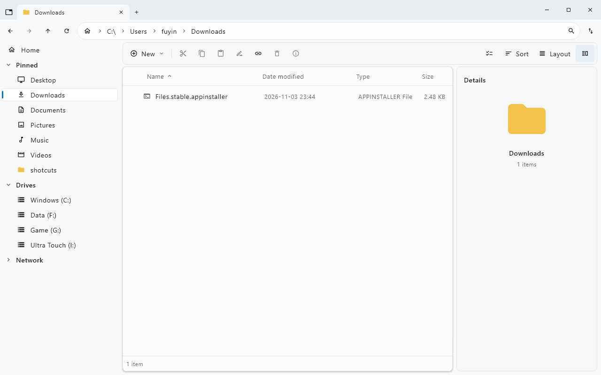
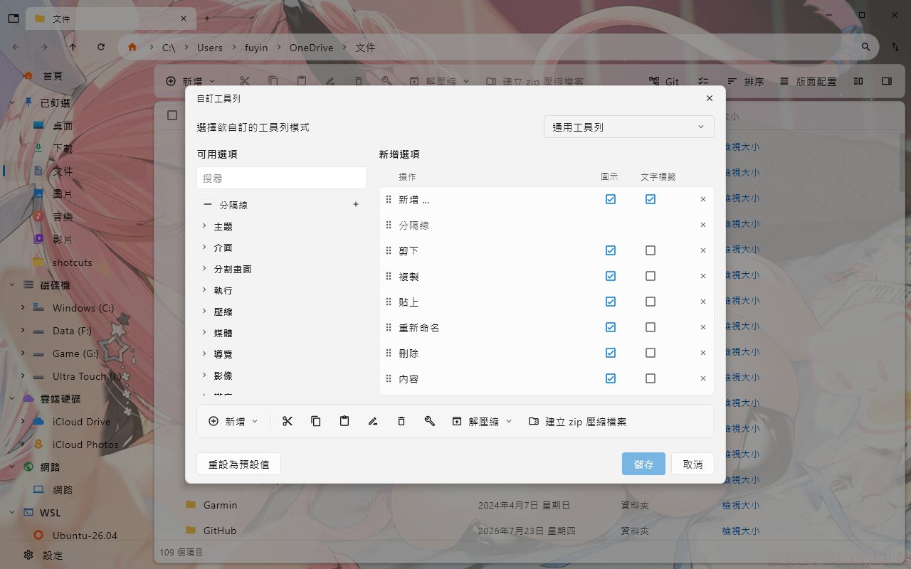

# FilesKmp 使用者手冊

繁體中文 | [English](USER-GUIDE.en.md) · [回到 README](../README.md) · [更新紀錄](../CHANGELOG.md)

本手冊依目前原始碼編寫（預設建置版本 `1.2.0`）。較早的已發布版本可能沒有部分功能。圖片取自儲存庫既有截圖，供辨識操作區域，實際畫面依版本與設定而異。

## 1. 安裝與第一次啟動

1. 在 [Releases](https://github.com/creamgod45/FilesKmp/releases) 選取符合 Windows 架構的 x64 或 ARM64 封裝；可在 Windows「設定 → 系統 → 關於」確認系統類型。
2. MSI：執行安裝精靈，再從捷徑啟動。預設安裝位置為 `%LOCALAPPDATA%\Programs\FilesKmp`。
3. ZIP：完整解壓縮，執行 `FilesKmp\FilesKmp.exe`。不要只移出 EXE；它需要旁邊的 runtime 與應用程式檔案。
4. 兩種封裝均內含 Java。介面依系統語言環境顯示繁體中文或英文；設定與快取均存於使用者資料夾。

## 2. 認識介面

*上方依序為分頁、路徑列與工具列；左側為導覽，中央為檔案清單，右側為詳細資料。此圖為英文介面範例。*

| 區域 | 用途 |
| --- | --- |
| 分頁列 | 切換資料夾工作區；`Ctrl+T` 新增、`Ctrl+W` 關閉 |
| 路徑列 | 點選路徑階層，或以 `Ctrl+L` 輸入資料夾路徑後按 Enter |
| 側邊欄 | 前往首頁、已釘選資料夾、磁碟機、網路及標籤 |
| 工具列 | 新增、複製、貼上、排序與版面配置等操作 |
| 檔案區 | 選取與開啟項目，右鍵查看適用命令 |
| 詳細資料面板 | `Ctrl+Alt+I` 開關，查看選取項目的資訊 |

首頁提供快速存取、磁碟機、標籤等小工具；可在設定中調整顯示內容。網路、WSL 與雲端位置是否出現取決於電腦上的可用位置與安裝狀態。

## 3. 瀏覽、分頁與分割畫面

- 在檔案區開啟資料夾，或以路徑列直接前往目的地；`F5` 重新整理。
- `Ctrl+Tab`／`Ctrl+Shift+Tab` 切換分頁；`Ctrl+1` 到 `Ctrl+9` 切換指定分頁。
- `Ctrl+Shift+T` 重開已關閉的分頁。
- `Ctrl+Shift+S` 建立左右分割。先點選要操作的窗格，再進行導覽、選取或貼上；可從分割畫面的工具列命令調整配置或關閉窗格。

## 4. 選取、複製、移動與刪除

1. 點選檔案；以 Ctrl 多選、Shift 選取範圍，或 `Ctrl+A` 全選。可在設定啟用選取核取方塊。
2. `Ctrl+C` 複製或 `Ctrl+X` 剪下，前往目的資料夾後按 `Ctrl+V`。
3. 檢查操作進度及遇到同名項目時的選項；大量操作請先以少量檔案確認目的位置。
4. 從工具列或右鍵選單刪除。一般刪除送至資源回收筒的行為依位置及 Windows 支援情況而定；`Shift+Delete` 是永久刪除，不會送入回收筒。
5. `Ctrl+Alt+R` 開啟資源回收筒，選取項目後使用還原命令；在回收筒可用 `Ctrl+Z` 還原選取項目。這不是所有檔案操作的通用復原功能。

安全刪除及清理類工具可能永久移除資料；執行前確認目標與畫面說明，並保留重要檔案備份。

## 5. 檢視、排序與預覽

從「版面配置」選擇詳細資料、清單、卡片或圖示。詳細資料欄位可依需求調整；排序命令可更換排序依據與方向。

| 預設快速鍵 | 檢視 |
| --- | --- |
| `Ctrl+Shift+1` | 詳細資料 |
| `Ctrl+Shift+2` | 清單 |
| `Ctrl+Shift+3` | 卡片 |
| `Ctrl+Shift+4` | 圖示 |

選取檔案後從選單使用快速預覽；可預覽的內容取決於檔案格式及 Windows 預覽處理常式。縮圖可在設定中開關。中繼資料編輯用 `Ctrl+Shift+M` 開啟；可寫入的欄位依檔案種類而異。

## 6. 搜尋

按 `Ctrl+F` 將焦點移到搜尋，輸入條件並依搜尋介面的範圍選項選擇要查找的位置。索引建立或更新時，結果可能需要等待；找不到項目時先確認搜尋範圍、大小寫及正規表示式開關。

| 輸入範例 | 意義 |
| --- | --- |
| `report` | 檔名包含 report |
| `ext:jpg;png` | JPG 或 PNG 圖片 |
| `file: size:>10mb` | 大於 10 MB 的檔案 |
| `dm:today` | 今天修改的項目 |
| `dm:>7d` | 最近七天修改 |
| `folder: backup` | 名稱包含 backup 的資料夾 |
| `path:\Photos\` | 完整路徑包含指定片段 |
| `*.pdf` | PDF 檔名萬用字元比對 |
| `regex:^IMG_\d+` | 正規表示式比對檔名 |

空格組合條件；`|` 表示或，`!` 排除條件。含空格的文字可加雙引號，例如 `"annual report"`。搜尋針對檔名、路徑及屬性，並非全文內容搜尋。

## 7. 批次命名、壓縮與標籤

**批次重新命名：** 選取檔案，按 `Ctrl+Shift+F2`，設定命名規則並查看預覽，確認後套用。單一重新命名使用 `F2`。

**ZIP：** 選取項目，從工具列或右鍵選單建立 ZIP；解壓縮時先選取壓縮檔，再選擇目的資料夾。支援程度依格式與系統工具而異。

**標籤：** 右鍵選取「編輯標籤」，勾選標籤或新增標籤；點側邊欄標籤即可集中瀏覽。標籤設定可調整名稱與顏色。標籤以路徑保存，於 FilesKmp 內重新命名或移動會跟隨更新；外部程式更動路徑後可能需要重新指定。

## 8. 捷徑流程與 AI 輔助

「鍵盤快速鍵」是按鍵綁定；「捷徑」是由多個動作組成的自動化流程。

1. 按 `Ctrl+Alt+S` 開啟「管理捷徑」。新增流程或匯入 `.fkflow.json`。
2. 在步驟編輯器加入輸入與動作，或切換 JSON 編輯。每個步驟的輸出可交給後續步驟。
3. 例如：取得選取檔案 → 篩選 `ext:jpg;png` → 複製到指定資料夾。
4. 先按「試跑」檢查記錄與資料流，再檢查來源、目的地及參數後正式執行。試跑會略過修改檔案／系統的動作，但仍可能執行讀取與 HTTP GET，並非完全離線的模擬。
5. 需要重複使用時儲存流程；可透過快捷鍵及工具列執行，格式細節見[捷徑參考](SHORTCUTS-SPEC.md)。

AI 輔助為選用功能；在捷徑的 AI 設定中選擇供應商、模型、位址及憑證，並檢查工具權限。對話及工具所提供的內容可能傳至設定的服務。套用 AI 產生的步驟前，請檢查刪除、覆寫、指令碼、網路及寄送訊息等動作；AI 設定不影響一般檔案瀏覽的使用。

## 9. 自訂外觀、工具列及按鍵

*既有繁體中文截圖：左側挑選命令，右側安排順序及圖示／文字標籤，下方可查看工具列預覽。背景圖片為使用者設定範例。*

- `Ctrl+,` 開啟設定，調整主題、背景、縮圖、隱藏檔案、副檔名、刪除確認、工作階段與首頁小工具。
- 在自訂工具列視窗新增或移除命令，以拖曳調整順序，檢查預覽後儲存。
- `F1` 或 `Ctrl+/` 開啟鍵盤快速鍵，搜尋命令、指定按鍵、清除或重設。衝突時先檢查有哪些命令共用同一組按鍵。
- 本手冊列出的都是預設按鍵；個人設定或更新後的實際綁定以快速鍵畫面為準。

## 10. Git、磁碟分析與更新資訊

在 Git 儲存庫資料夾使用 Git 選單查看適用操作，包含修補檔建立與套用；請先確保 Git 可從環境中執行，並在變更檔案前確認工作目錄狀態。

磁碟分析可檢視空間使用；啟用使用量記錄後才會保存磁碟歷史。掃描大型或網路資料夾需要較長時間。

更新資訊頁說明新版對設定與快速鍵的影響；程式在遷移設定前會建立備份。此頁是本機設定遷移報告，已發布功能歷史請查閱 [changelog](../CHANGELOG.md)。

## 11. 資料位置、備份與疑難排解

| 位置 | 內容 |
| --- | --- |
| `%APPDATA%\FilesKmp` | 設定、標籤、工具列、快速鍵、工作階段與更新報告等 |
| `%LOCALAPPDATA%\FilesKmp\Cache` | 可重建的縮圖及原生函式庫等快取 |
| `%LOCALAPPDATA%\FilesKmp\History` | 啟用記錄後產生的磁碟使用量歷史 |
| `%LOCALAPPDATA%\Programs\FilesKmp` | MSI 預設安裝位置 |

關閉程式後備份設定資料夾；需要磁碟歷史時另備份 History。免安裝版亦使用上述資料位置。

| 情況 | 處理方式 |
| --- | --- |
| ZIP 版無法啟動 | 確認已完整解壓縮、runtime 仍在原處，且架構正確 |
| 無法存取資料夾或網路位置 | 先確認 Windows 權限、網路連線及共用位置是否可存取 |
| 搜尋無結果 | 確認範圍及條件，先使用簡單檔名搜尋，等待索引更新 |
| 無預覽或縮圖 | 確認已啟用，並確認格式及系統預覽處理常式是否支援 |
| Git 或外部命令失敗 | 確認程式已安裝、PATH 可找到，且工作目錄正確 |
| 按鍵執行了其他命令 | 用 F1 檢查個人綁定及衝突 |

仍有問題時，在 [Issues](https://github.com/creamgod45/FilesKmp/issues) 提供版本、Windows 架構、重現步驟及經遮蔽個資的截圖／錯誤記錄。
